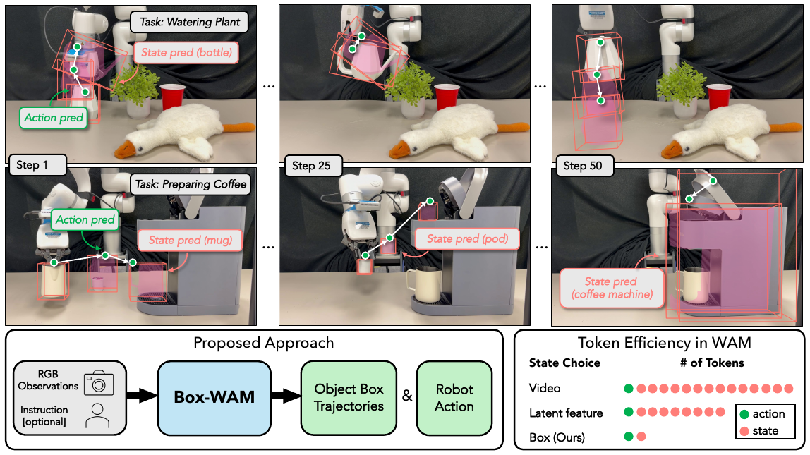

<p align="center">
  
</p>

---

# Box-WAM

[](https://box-wam.github.io/)
[](https://box-wam.github.io/)
[](https://www.corl.org/)
[](https://www.python.org/downloads/)
[](LICENSE)

*Box Trajectories as Compact State Representations for World Action Models* · Qinxi Yu, Wenzhou Ding,
Gloria X. Wang, Albert J. Zhai, Shenlong Wang · CoRL 2026 ·
[Project page](https://box-wam.github.io/) · [Paper](https://box-wam.github.io/)

## Install

```bash
# includes our forks of openpi (multitask/openpi-boxwam) and RoboTwin 2.0 (eval/RoboTwin-boxwam)
git clone https://github.com/quincy-u/box-wam.git
cd box-wam

# RoboTwin-boxwam: RoboTwin 2.0 with box annotations, in the conda env `RoboTwin`
# (RoboTwin's own instructions: https://robotwin-platform.github.io/doc/usage/robotwin-install.html)
conda create -n RoboTwin python=3.10 && conda activate RoboTwin
conda install -y -c nvidia/label/cuda-12.8.1 cuda-nvcc cuda-cudart-dev   # pytorch3d and curobo compile CUDA code
conda install -y -c conda-forge ninja ffmpeg                               # curobo kernel builds, rollout videos
(cd eval/RoboTwin-boxwam && bash script/_install.sh && bash script/_download_assets.sh \
    && python script/reannotate_obb.py)

# box-wam (evaluation runner, box rendering, standalone policy) and the openpi client, in the same env
pip install -e ".[data]" -e multitask/openpi-boxwam/packages/openpi-client

# openpi-boxwam: training and serving pi0.5 + Box-WAM, in its own uv env multitask/openpi-boxwam/.venv
# (see openpi's README for GPU requirements)
(cd multitask/openpi-boxwam && GIT_LFS_SKIP_SMUDGE=1 uv sync)
```

## Checkpoints

| Hugging Face repository | Contents |
|---|---|
| [`quincyu/pi05_robotwin_obb_eef`](https://huggingface.co/quincyu/pi05_robotwin_obb_eef) | pi0.5 + Box-WAM, step 34999 (12 GB), openpi-boxwam config `pi05_robotwin_boxwam` |
| [`quincyu/box-wam-standalone`](https://huggingface.co/quincyu/box-wam-standalone) | standalone Box-WAM, `robotwin/<task>.pt` for nine RoboTwin 2.0 tasks, config `configs/train/robotwin.yaml` |
| [`quincyu/robotwin_eef_obb_27500`](https://huggingface.co/datasets/quincyu/robotwin_eef_obb_27500) (dataset) | 27,500 RoboTwin 2.0 episodes with box annotations, training data of pi0.5 + Box-WAM |

## pi0.5 + Box-WAM

Box-WAM as a prediction head of pi0.5, fine-tuned on 50 RoboTwin 2.0 tasks. The changes to openpi are described in
[`multitask/README.md`](multitask/README.md).

### Train

```bash
# dataset: 27,500 RoboTwin 2.0 episodes with box annotations (LeRobot v2.1, ~100 GB)
cd multitask/openpi-boxwam
uv run huggingface-cli download quincyu/robotwin_eef_obb_27500 --repo-type dataset \
    --local-dir ~/.cache/huggingface/lerobot/quincyu/robotwin_eef_obb_27500

uv run scripts/compute_norm_stats.py --config-name pi05_robotwin_boxwam
XLA_PYTHON_CLIENT_MEM_FRACTION=0.9 uv run scripts/train.py pi05_robotwin_boxwam --exp-name boxwam
```

Checkpoints go to `checkpoints/pi05_robotwin_boxwam/boxwam/<step>/`. To use your own demonstrations, record them
with RoboTwin-boxwam (task configs `demo_clean_eef` / `demo_randomized_eef`) and convert them with
`scripts/robotwin/` in openpi-boxwam.

### Evaluate

```bash
# serve the released checkpoint (35k steps, 12 GB)
cd multitask/openpi-boxwam
uv run huggingface-cli download quincyu/pi05_robotwin_obb_eef --local-dir checkpoints/pi05_robotwin_boxwam/release
uv run scripts/serve_policy.py --port 8000 policy:checkpoint \
    --policy.config pi05_robotwin_boxwam --policy.dir checkpoints/pi05_robotwin_boxwam/release/34999

# in a second shell, from box-wam: RoboTwin 2.0, all 50 tasks, 100 trials each (--tasks / --episodes to restrict)
conda activate RoboTwin
python scripts/evaluate_robotwin.py --config configs/eval/robotwin_pi05.yaml --task-config demo_clean --gpus 0 1
python scripts/evaluate_robotwin.py --config configs/eval/robotwin_pi05.yaml --task-config demo_randomized --gpus 0 1
```

Results go to `results/<label>/<task_config>/`: `summary.md` with the success rates, `videos/` with the rollout
videos and the predicted boxes drawn on them (green: just predicted, red: end of the 50-step chunk), and
`boxes/` with the raw predicted trajectories. The RoboTwin simulator occasionally hangs; the runner kills a run whose log
stops for `stall_minutes` and restarts it from its first episode up to `retries` times, so a long run can still end
without a result (`success rate None`, exit -2) and needs to be rerun, or split into more seeds with fewer episodes each.

## Standalone Box-WAM

A single-task policy trained from 50 demonstrations: a frozen DINOv3 ViT-L/16 encoder and a 130M-parameter
rectified-flow transformer that jointly denoise the box trajectory and the action chunk. The configuration keys
are documented in [`boxwam/config.py`](boxwam/config.py).

### Data

Training data is a set of episode directories. An episode with `T` steps contains:

| File | Shape | Content |
|---|---|---|
| `video_<camera>.npy` | `(T, 224, 224, 3)` uint8 | RGB frames of one camera |
| `state.npy` | `(T, state_dim)` | joint positions and gripper opening |
| `action.npy` | `(T, action_dim)` | commanded target; for RoboTwin the next joint state |
| `proj_3d_obb.npy` | `(T, K, 16)` | the eight box corners `(u0, v0, …, u7, v7)` of each of `K` tracked objects in the pixels of the first camera; all zeros for an empty slot |
| `valid_idx.npy` | `(M,)` int | optional: window starts to sample from (`scripts/filter_static_chunks.py`) |

A training sample is the frame and state at `t`, the actions `t … t + H − 1` and the boxes `t + 1 … t + H`.
Corner `i` has the sign pattern `((i >> 2) & 1, (i >> 1) & 1, i & 1)` along the box axes, so the twelve box
edges connect corners that differ in one bit. RoboTwin demonstrations are prepared as follows:

```bash
# in eval/RoboTwin-boxwam: 50 demo_clean demonstrations with box annotations, for each task
bash collect_data.sh open_laptop demo_clean 0     # <task> <task_config> <gpu>

# in box-wam: convert to episode directories, compute normalisation statistics, skip windows without motion
python scripts/prepare_robotwin_episodes.py --robotwin-data eval/RoboTwin-boxwam/data --task-config demo_clean \
    --tasks adjust_bottle beat_block_hammer click_alarmclock grab_roller handover_mic lift_pot open_laptop \
            pick_dual_bottles turn_switch --output data/robotwin
python scripts/compute_action_stats.py --episodes data/robotwin/episodes.txt --horizon 15 --gripper-dims 6 13 \
    --output data/robotwin/action_stats.npz
python scripts/filter_static_chunks.py --episodes data/robotwin/episodes.txt --horizon 15 --gripper-dims 6 13
```

### Train

```bash
# one RoboTwin task; --task filters the episodes and names the run
python scripts/train.py --config configs/train/robotwin.yaml --task open_laptop --devices cuda:0
python scripts/train.py --config configs/train/robotwin.yaml --task pick_dual_bottles --set model.box_dim=32
```

Any config value can be overridden with `--set section.key=value`; `--resume` continues an interrupted run.
Runs write `latest.pt`, `best.pt` (lowest validation action error), `metrics.jsonl` and `train_log.csv` to
`checkpoints/<run_name>/`.

### Evaluate

```bash
huggingface-cli download quincyu/box-wam-standalone --local-dir checkpoints/standalone
# paper protocol: 3 seeds x 50 trials, unseen instructions, 50 Euler steps, 15-step chunks executed completely
python scripts/evaluate_robotwin.py --config configs/eval/robotwin_boxwam.yaml \
    --checkpoint checkpoints/standalone/robotwin/open_laptop.pt --tasks open_laptop \
    --task-config demo_clean --seeds 1 2 3 --episodes 50 --gpus 0
```

Results are written as for pi0.5 + Box-WAM above. Checkpoints are self-contained (weights, config, normalisation
statistics) and can also be used directly; `scripts/benchmark_latency.py` measures their inference latency.

```python
from boxwam.policy import BoxWAMPolicy
policy = BoxWAMPolicy.from_checkpoint("checkpoints/standalone/robotwin/open_laptop.pt", device="cuda:0")
out = policy.act([head_camera_rgb], joint_positions)   # out.actions: (15, 14), out.boxes: (15, 1, 8, 2)
```

## License

Box-WAM is released under the MIT license ([LICENSE](LICENSE)). Third-party code and models and their licenses
are listed in [THIRD_PARTY_NOTICES.md](THIRD_PARTY_NOTICES.md).

## Acknowledgements

The multi-task model builds on Physical Intelligence's [openpi](https://github.com/Physical-Intelligence/openpi)
and pi0.5; the standalone transformer blocks were adapted from Meta's [V-JEPA 2](https://github.com/facebookresearch/vjepa2);
simulation uses [RoboTwin 2.0](https://github.com/RoboTwin-Platform/RoboTwin); the image encoder is
[DINOv3](https://github.com/facebookresearch/dinov3) through [timm](https://github.com/huggingface/pytorch-image-models).
Thanks to all of these teams for open-sourcing their work.

We thank Henry Che for helping with the real-world robot experiments.

If you find Box-WAM useful in your research, please cite:

```bibtex
@inproceedings{yu2026boxwam,
  title     = {Box Trajectories as Compact State Representations for World Action Models},
  author    = {Yu, Qinxi and Ding, Wenzhou and Wang, Gloria X. and Zhai, Albert J. and Wang, Shenlong},
  booktitle = {Conference on Robot Learning (CoRL)},
  year      = {2026}
}
```
